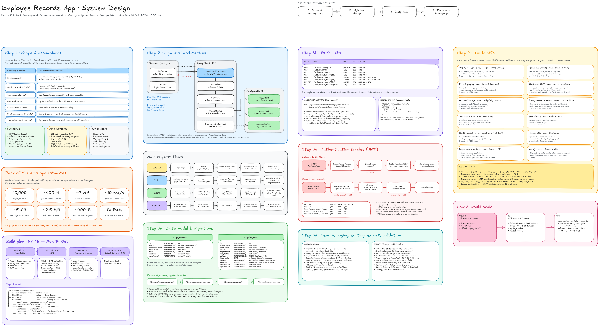
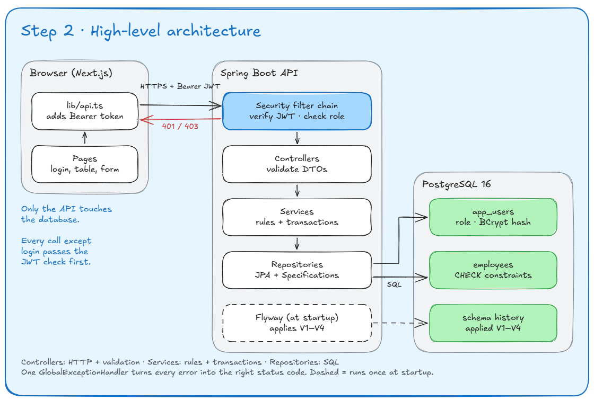

# Pesira Employee Records

Manage employee records in a web app: Spring Boot API with JWT roles, Next.js frontend, PostgreSQL.



## Live demo

| Part     | URL                                                   |
|----------|-------------------------------------------------------|
| Frontend | <https://pesira-employee-records-frontend.vercel.app> |
| API base | `https://pesira-api.169.58.177.148.nip.io/api`        |

| Email               | Password    | Role  | Can do                                              |
|---------------------|-------------|-------|-----------------------------------------------------|
| `admin@example.com` | `Admin123!` | ADMIN | Everything a User can, plus add, edit and delete    |
| `user@example.com`  | `User123!`  | USER  | View, search, filter, sort, page through and export |

There is no cold start: the API runs all the time on a VPS. Every reviewer shares the same demo data.

## Features

- JWT login with Admin and User roles; the API checks the role on every request.
- Employee create, read, update and delete; only Admin can change data.
- Table with search, status filter, sortable columns, pagination, and edit and delete actions.
- Search, filtering, sorting and paging all run on the server.
- Validation in the browser and on the server; server errors appear under the matching field.
- Export of the current search, filter and sort as CSV or JSON.
- Flyway migrations create the schema and seed two demo users and 60 employees.

## Tech stack

| Layer         | Technology                                           | Version              |
|---------------|------------------------------------------------------|----------------------|
| API language  | Java                                                 | 25                   |
| API framework | Spring Boot (Web MVC, Data JPA, Validation)          | 4.1.1                |
| Security      | Spring Security, OAuth2 resource server, HS256 JWT   | 7.1.1                |
| ORM           | Hibernate                                            | 7.4.5                |
| Migrations    | Flyway                                               | 12.4.0               |
| Database      | PostgreSQL                                           | 16                   |
| Frontend      | Next.js (App Router), React, TypeScript, CSS Modules | 16.4.2, 19.3.0, 5.9  |
| Tests         | JUnit, MockMvc, Testcontainers                       | Testcontainers 2.0.5 |
| Build         | Maven wrapper, npm                                   | Maven 3.10.0         |

## Architecture



The browser only calls its own origin, and Next.js forwards `/api/*` to the Spring Boot API at `API_URL`.
Spring Security verifies the bearer JWT and the role before any controller runs.
Controllers validate the request, services apply rules in a transaction, and repositories query PostgreSQL.
Every error comes back as RFC 7807 Problem Details.
The full board is in a [read-only Excalidraw snapshot](https://excalidraw.com/#json=bWrBKrJXH0lBJPsB4Oy6i,IL5EyamP9s5TSoaJvxluIg).

## Run it locally

Prerequisites: JDK 25, Node.js 20.9 or newer (tested on 24), Docker Desktop, and Git.
Commands are for bash (Git Bash on Windows); Windows variants are in the comments.

```bash
git clone https://github.com/njange/pesira-employee-records.git
cd pesira-employee-records
cp .env.example .env            # Windows cmd: copy .env.example .env
openssl rand -base64 48         # paste the output into JWT_SECRET in .env
```

Run everything in Docker, then open <http://localhost:3000>. The first build takes a few minutes.

```bash
docker compose up -d --build
```

Or run the backend and frontend from source, with only PostgreSQL in Docker:

```bash
docker compose up -d postgres
cd backend
./mvnw spring-boot:run          # Windows: mvnw.cmd spring-boot:run
```

In a second terminal, from the repository root:

```bash
cd frontend
npm ci
cp .env.example .env.local      # Windows cmd: copy .env.example .env.local
npm run dev
```

Open <http://localhost:3000> and log in with a demo login from above.
Use `localhost`, not `127.0.0.1`: the backend's CORS list only allows `http://localhost:3000`.

Troubleshooting:

- **Port 5432 is taken:** in `.env`, set `DB_PORT` to a free port and use it in `DB_URL` too.
  For Docker-only runs, `BACKEND_PORT` and `FRONTEND_PORT` move 8080 and 3000.
- **`JWT_SECRET must be at least 32 bytes`:** `.env` still has `replace-me`; paste a generated secret into it.
- **Docker is not running:** `docker compose` cannot reach the engine, and tests fail with
  `Could not find a valid Docker environment`. Start Docker Desktop.

## Running tests

Docker must be running: the integration tests start their own PostgreSQL 16 with Testcontainers.

```bash
cd backend
./mvnw test                     # Windows: mvnw.cmd test
```

The frontend has no unit tests; `npm run lint` and `npm run build` check it.

## API reference

| Method + path                | Role   | Success                        | Errors                  |
|------------------------------|--------|--------------------------------|-------------------------|
| `POST /api/auth/login`       | public | 200 `{token, expiresAt, user}` | 400, 401                |
| `GET /api/auth/me`           | any    | 200 current user               | 401                     |
| `GET /api/employees`         | any    | 200 page of employees          | 400, 401                |
| `GET /api/employees/{id}`    | any    | 200 employee                   | 401, 404                |
| `POST /api/employees`        | ADMIN  | 201 + `Location` header        | 400, 401, 403, 409      |
| `PUT /api/employees/{id}`    | ADMIN  | 200 employee                   | 400, 401, 403, 404, 409 |
| `DELETE /api/employees/{id}` | ADMIN  | 204                            | 401, 403, 404           |
| `GET /api/employees/export`  | any    | 200 file download              | 400, 401                |

A 409 means a duplicate email, or a stale `version` on update. Send the `version` you last read.

| Parameter    | Meaning                                                                       |
|--------------|-------------------------------------------------------------------------------|
| `search`     | Case-insensitive match in first name, last name, email or job title           |
| `department` | Case-insensitive exact match                                                  |
| `status`     | `ACTIVE`, `ON_LEAVE` or `TERMINATED`                                          |
| `sort`       | `field,asc` or `field,desc`, default `lastName,asc`                           |
|              | Fields: `firstName lastName email department jobTitle salary hireDate status` |
| `page`       | List only; from 0, default 0                                                  |
| `size`       | List only; 1 to 100, default 20                                               |
| `format`     | Export only, required: `csv` or `json`; at most 10,000 rows                   |

Log in and keep the token. For the live API, set `API=https://pesira-api.169.58.177.148.nip.io`.

```bash
API=http://localhost:8080
TOKEN=$(curl -s $API/api/auth/login -H 'Content-Type: application/json' \
  -d '{"email":"admin@example.com","password":"Admin123!"}' | sed -E 's/.*"token":"([^"]+)".*/\1/')
```

List active employees matching "an", highest salary first:

```bash
curl -s "$API/api/employees?search=an&status=ACTIVE&sort=salary,desc&page=0&size=1" -H "Authorization: Bearer $TOKEN"
```

```json
{
  "content": [
    {"id": 12, "firstName": "Brian", "lastName": "Mwangi", "email": "brian.mwangi@example.com",
     "department": "Engineering", "jobTitle": "Software Engineer", "salary": 109844.00,
     "hireDate": "2020-09-11", "status": "ACTIVE", "version": 0,
     "createdAt": "2026-10-18T16:31:08.739317Z", "updatedAt": "2026-10-18T16:31:08.739317Z"}
  ],
  "page": 0, "size": 1, "totalElements": 32, "totalPages": 32
}
```

Export the same filter to a file:

```bash
curl -s -o employees.csv "$API/api/employees/export?format=csv&search=an&status=ACTIVE" -H "Authorization: Bearer $TOKEN"
```

Errors use Problem Details (`application/problem+json`). Validation errors add `fieldErrors`, as here for `size=101`:

```json
{"detail": "1 field is invalid", "instance": "/api/employees", "status": 400, "title": "Validation failed",
 "fieldErrors": [{"field": "size", "message": "must be less than or equal to 100"}]}
```

## Database and migrations

| Migration                  | What it does                                                            |
|----------------------------|-------------------------------------------------------------------------|
| `V1__create_app_users.sql` | `app_users` table with a role check and a case-insensitive unique email |
| `V2__create_employees.sql` | `employees` table with checks, a `version` column and indexes           |
| `V3__seed_users.sql`       | The two demo users, with BCrypt password hashes                         |
| `V4__seed_employees.sql`   | 60 sample employees                                                     |

An applied migration is never edited; a change goes in a new `V5__...` file.
Hibernate only validates the schema (`ddl-auto: validate`) and never changes it.

## Project structure

```text
backend/               Spring Boot API (Maven)
  src/main/java/       auth, user, employee, export, common (errors, paging)
  src/main/resources/  application.yml and db/migration (V1 to V4)
  src/test/java/       integration tests (MockMvc and Testcontainers)
frontend/              Next.js app
  app/                 login and employees pages
  components/          table, pagination, form and dialogs
  lib/                 API client, session, URL state, validation, formatting
deploy/                production compose file and nginx site for the VPS
docs/design/           design board and architecture images
```

## Deployment

| Part     | Runs on                                 | How a deploy happens                                                 |
|----------|-----------------------------------------|----------------------------------------------------------------------|
| Frontend | Vercel, root directory `frontend`       | Vercel builds `frontend/`; redeploy after changing `API_URL`         |
| API      | Contabo VPS, Docker, behind host nginx  | Manual: `git pull`, then `docker compose up -d --build` in `deploy/` |
| Database | PostgreSQL 16 container on the same VPS | Started by the same compose file; no public port                     |

nginx serves the API over HTTPS with a Let's Encrypt certificate; see [deploy/nginx-site.conf](deploy/nginx-site.conf).
Variables live in `.env` (local), `frontend/.env.local`, `deploy/.env` (VPS) and the Vercel project settings.

| Variable               | Used by                 | Example                                               | Required                     |
|------------------------|-------------------------|-------------------------------------------------------|------------------------------|
| `JWT_SECRET`           | Backend                 | output of `openssl rand -base64 48`                   | Yes, at least 32 bytes       |
| `DB_URL`               | Backend run from source | `jdbc:postgresql://localhost:5432/records`            | No (this default)            |
| `DB_USERNAME`          | Backend, PostgreSQL     | `records`                                             | No (this default)            |
| `DB_PASSWORD`          | Backend, PostgreSQL     | `records` locally, random in production               | Yes in production            |
| `DB_NAME`              | PostgreSQL in compose   | `records`                                             | No (this default)            |
| `DB_PORT`              | Compose host port       | `5432`                                                | No (this default)            |
| `CORS_ALLOWED_ORIGINS` | Backend                 | `https://pesira-employee-records-frontend.vercel.app` | No (`http://localhost:3000`) |
| `BACKEND_PORT`         | Compose host port       | `8080` locally, `5200` on the VPS                     | No                           |
| `FRONTEND_PORT`        | Compose host port       | `3000`                                                | No (this default)            |
| `API_URL`              | Frontend build          | `https://pesira-api.169.58.177.148.nip.io`            | Yes on Vercel                |

`CORS_ALLOWED_ORIGINS` is comma-separated and accepts `*`, which covers Vercel preview URLs.

## Design decisions and assumptions

- Stateless JWT (HS256) with a 60-minute expiry and no server sessions.
- Search, filtering, sorting and paging run in the database, with `id` as a stable tie-breaker.
- Optimistic locking: an update must send the `version` it read, or it gets a 409.
- Hard delete behind a confirm dialog; there is no soft delete.
- The User role can read and export only. The API enforces it; the UI only hides buttons.
- There is no sign-up; accounts come from a Flyway seed.
- The browser reaches the API through the Next.js proxy, so it only talks to one origin.

Full reasoning and trade-offs: [DESIGN.md](DESIGN.md)

## Known limitations and next steps

- No refresh tokens or revocation: a token stays valid until it expires.
- The token lives in `sessionStorage`, so an XSS bug could read it.
- No audit history of who changed what.
- Offset paging and `ILIKE` search suit about 10,000 rows; beyond that, add keyset paging and a trigram index.
- The frontend has no automated tests.
